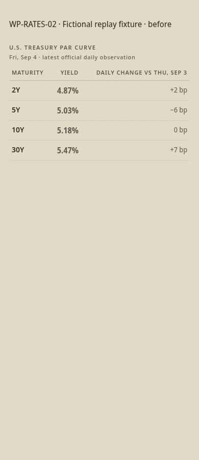
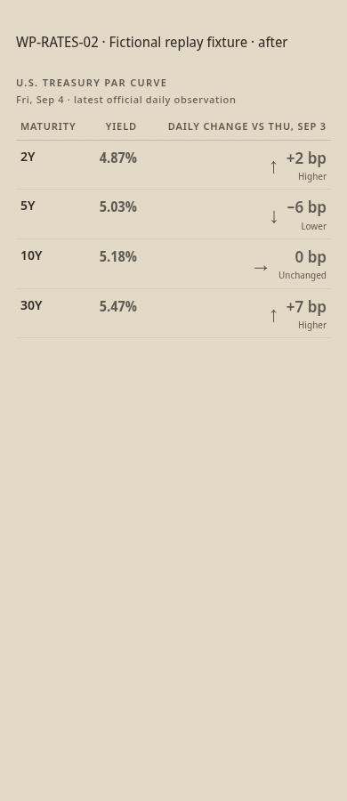
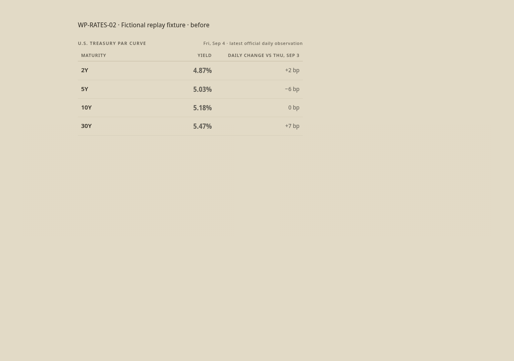
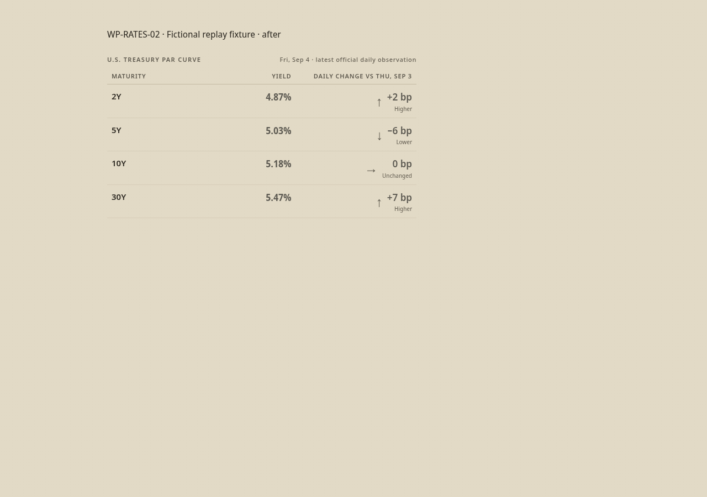

# WP-RATES-02 evidence

Base: verified remote main `06a8c2da8bd3e9311391edcad24fa9fc0fd2d9f6`.

The screenshots show the Treasury table extracted from rendered fictional replay data, not a live market snapshot. Identical fixture values before/after: 2Y +2 bp, 5Y −6 bp, 10Y 0 bp, 30Y +7 bp. The observation date and verified daily baseline remain visible. Phone: 390×900; desktop: 1280×900. Full-page overflow checks cover 320, 390 and 1280 px.

- Rates module, rates contract, render and new visual clarity tests: 54 passed.
- Reading pass, evidence integrity and curve tests: 141 passed.
- `git diff --check`: passed.

Executed with system Python 3.13 and existing project virtualenv site packages (the virtualenv launcher references an unavailable interpreter). Chrome used an isolated temporary user-data directory because its default directory was unavailable. No dependencies were added.

Existing rates tests cover stale suppression, missing tenors and verified shared baselines. Data collection, comparison logic, evidence gates, markdown output and freshness handling are unchanged.

## Phone

Before | After
--- | ---
 | 

## Desktop

Before | After
--- | ---
 | 
